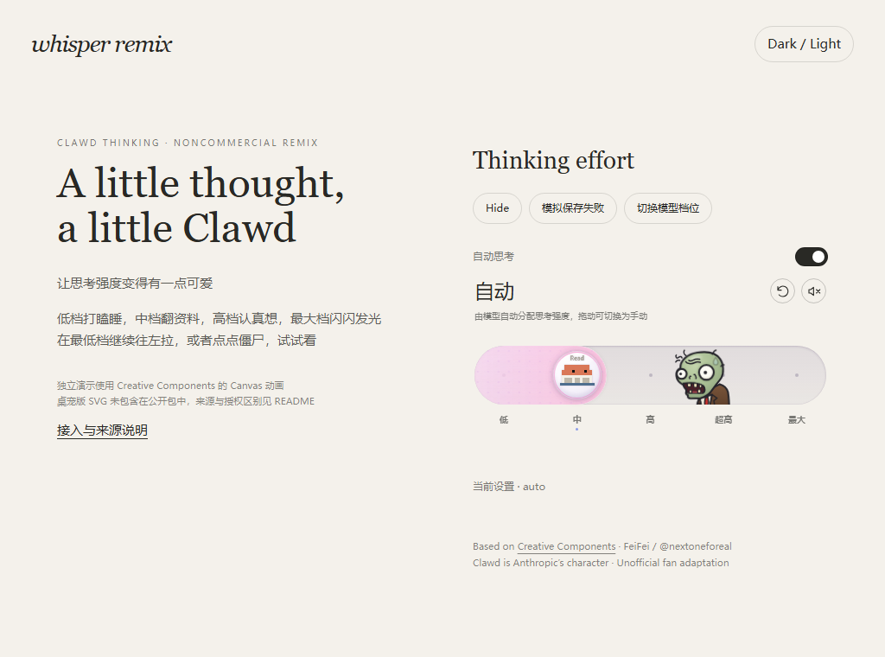

# Clawd Thinking · Whisper 二改版

把 Creative Components 的思考强度组件改成 Clawd 主题：保留原版僵尸、弹簧拖动、咬一口和彩蛋，配合 Clawd 的睡觉、翻书、思考和金色动画

这是为 Whisper 整理的独立组件包，使用原生 JavaScript 接入，不依赖 Whisper 的聊天后台或页面全局变量

**非商业用途**，遵守原项目的 PolyForm Noncommercial 1.0.0 与 Required Notice，商用需要联系原作者，不是 MIT 项目



## 原作与二改

| 来源 | 作者 | 实际使用的内容 |
| --- | --- | --- |
| [Creative Components](https://github.com/next1foreal-dotcom/creative-components) | FeiFei / [@nextoneforeal](https://github.com/next1foreal-dotcom) | `thinking-effort` 僵尸思考条、弹簧与咬一口机制、SVG 场景、音效与语音，以及 `clawd-perch/clawd-engine.js` 的 Canvas Clawd 动画 |
| [Clawd on Desk](https://github.com/rullerzhou-afk/clawd-on-desk) | 鹿鹿 / [@rullerzhou-afk](https://github.com/rullerzhou-afk) 及贡献者 | Whisper 站内版使用了此项目的睡眠、思考、强化思考、眩晕 SVG 动画，**本公开包没有复制这些 SVG 或桌宠实现代码** |
| Whisper 二次开发 | Whisper contributors | Clawd 替换、自动思考开关、独立音效按钮、主题适配、加载优化、触屏事件隔离、保存失败回退，以及这份独立接入层 |

Clawd 角色归 Anthropic 所有，本项目为非官方同人改编，与 Anthropic 无隶属或背书关系

### 为什么独立演示和站内版的部分动作不同

Clawd on Desk 的程序代码使用 AGPL-3.0，但其美术素材采用单独条款，原项目明确保留相关版权；“代码开源”不等于“SVG 可以自由转载”

因此，公开包默认只使用 Creative Components 提供的 Canvas Clawd 动画，保留两处来源的准确说明；站内版使用的四张 SVG 仅列在 [来源清单](docs/desktop-artwork-manifest.json)，没有包含原图、裁切图或含这些 SVG 的截图，也不自动从上游下载它们

如果已经取得相应美术素材的再分发授权，可通过 `assets` 参数接入自己的文件，详见 [素材与许可](docs/ASSETS.md)

## 快速预览

需要 Node.js 22 或以上，无需安装 npm 依赖

```bash
npm start
```

打开 `http://127.0.0.1:4173`，静态演示也可以直接部署到 GitHub Pages 等静态托管

不要双击 `demo/index.html` 使用 `file://` 打开，组件需要 HTTP 提供 ES Module 和音频资源

## 接入

保留 `src/` 和 `vendor/` 的相对目录关系

```html
<link rel="stylesheet" href="./src/clawd-thinking.css">
<div id="effort"></div>
<script type="module">
  import {createClawdThinking} from './src/clawd-thinking.js';

  const thinking = createClawdThinking(document.querySelector('#effort'), {
    levels: ['low', 'medium', 'high', 'max'],
    value: 'auto',
    theme: 'auto',
    async onChange(value, {previousValue}) {
      // 在自己的应用里保存 value
      // 如果保存失败，抛出 Error，组件会回到 previousValue
    }
  });
</script>
```

**`levels` 应当来自你实际使用的模型能力**，组件不会调用模型，也不会自行提高模型的思考强度；`auto` 只代表让宿主应用交给模型或运行时处理

## 参数与控制器

| 参数 | 默认值 | 说明 |
| --- | --- | --- |
| `levels` | `['low','medium','high','max']` | 实际支持的手动档位，可包含 `xhigh`，可为空数组 |
| `value` | `'auto'` | 当前设置，必须是 `auto` 或一个支持的手动档位 |
| `recommended` | `'medium'` | 重置对应的档位，不支持时使用第一个手动档位 |
| `theme` | `'auto'` | `light`、`dark` 或跟随系统 |
| `sound` | `false` | 是否开启音效 |
| `storageKey` | 无 | 可选的音效偏好 localStorage 键，不会默认写入存储 |
| `initiallyOpen` | `true` | 在侧边栏中使用可设为 `false`，由打开按钮调用 `show()` |
| `onChange(value, metadata)` | 无 | 可以返回 Promise，拒绝或抛错时回退 |
| `onError(error)` | 无 | 保存失败回调 |
| `assets` | 无 | 可选的、已获得适当授权的 SVG 或图片 URL 映射 |

控制器提供 `ready`、`value`、`sound`、`element`、`show()`、`hide()`、`setValue(value)`、`setLevels(levels, value='auto')`、`setTheme(theme)`、`destroy()`

`setValue()` 同步宿主状态，不触发保存回调；用户操作保存成功后会发出 `effort-change`，失败发出 `effort-error`，音效偏好变化发出 `sound-change`，资源加载失败发出 `load-error`

切换模型时调用 `setLevels()`，保存过程中不要切换模型或调用 `setValue()`；`hide()` / `destroy()` 会停止动画并释放音频

## 侧边栏与首次音效

```js
import {createClawdThinking, preloadClawdThinking} from './src/clawd-thinking.js';

void preloadClawdThinking(); // 只准备依赖，不创建隐藏的动画循环
const thinking = createClawdThinking(container, {
  initiallyOpen: false,
  storageKey: 'my-app-thinking-sound'
});

openButton.addEventListener('click', () => { void thinking.show(); });
closeButton.addEventListener('click', () => thinking.hide());
```

浏览器通常要求先有用户操作才能播放声音；在真实按钮的 `click` 回调中直接调用 `show()`，已保存的音效偏好就能借这次操作唤醒音频，不要先 `await` 其他请求再调用

## 主题

可在组件或父元素上覆盖这些变量

```css
#effort {
  --clawd-foreground: #eeeeea;
  --clawd-secondary: #adada8;
  --clawd-outline: #ffffff55;
  --clawd-surface: #252522;
  --clawd-font: system-ui, sans-serif;
}
```

## 目录

```text
src/                       独立接入层和样式
demo/                      无后端演示
vendor/creative-components/ 固定版本依赖、原作者音频和许可
vendor/upstream/            原版源码参考与原始 standalone bundle
scripts/                   本地服务、可复现补丁与打包脚本
tests/                     独立浏览器测试
docs/                      来源清单、素材说明和预览
LICENSE                    PolyForm Noncommercial 1.0.0 与 Required Notice
THIRD_PARTY_NOTICES.md      逐项来源、版本和署名
```

原项目固定版本为 `3ff64a171b53b11d6d79e7bb11d499ba5e55f1cf`，当前代码和音频可直接从仓库运行，无需第三方 CDN

## 验证与上传

```bash
npm run check
node tests/browser.mjs  # 需要本机 Chrome，可设置 CHROME_PATH
python scripts/rebuild-vendor.py  # 可选：从保留的原始 bundle 精确重建翻译和音频修复
python scripts/package-release.py  # 用明确清单生成公开 zip
```

将压缩包解压后，把这个目录内的文件上传到一个新 GitHub 仓库即可，建议仓库名 `clawd-thinking-component`，不要只把 zip 文件作为仓库内容上传，也不要把 Whisper 项目整体上传

若要展示在线演示，可在仓库 Settings → Pages 中选择从分支根目录发布，根目录的 `index.html` 会转到演示页

`private-assets/` 被忽略，公开 zip 使用明确文件清单打包；包内不包含聊天记录、角色、服务器配置、密钥、生产地址或账号数据

## 致谢与许可

Required Notice: Copyright (c) 2026 FeiFei (@nextoneforeal) — https://github.com/next1foreal-dotcom/creative-components

保留 [LICENSE](LICENSE)、[第三方声明](THIRD_PARTY_NOTICES.md) 和 [原作者商用说明](vendor/creative-components/COMMERCIAL.md)，本仓库新增适配部分也按同一非商业条款提供，不修改原作者或其他权利人的权利

桌宠的程序和美术素材许可分开列明，不能用本仓库的许可覆盖其 SVG；Preact 的 MIT 许可另附于 [PREACT-LICENSE.txt](vendor/creative-components/PREACT-LICENSE.txt)
